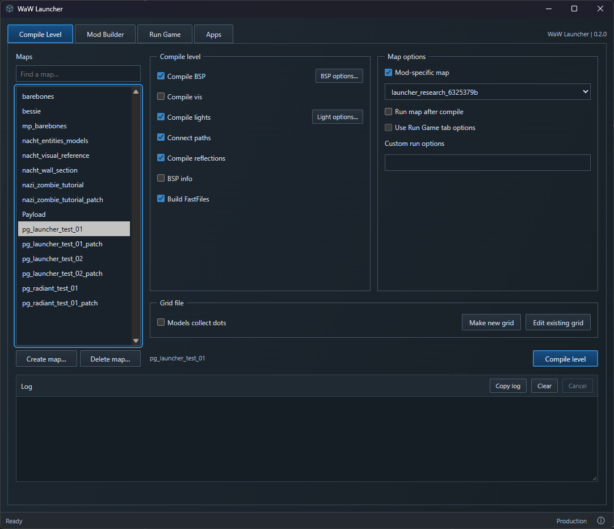

# WaW Launcher

**An unofficial community app. Not affiliated with Treyarch, Activision or UGX.**

The original World at War Modtools Launcher workflows with a new UI. Open the editors, build mods, compile levels and run the game. Made by [phil81334](https://github.com/phil81334), using JavaScript, Rust, Vite and Tauri.

It runs your installed Modtools executables with the original commands and stage order. It does not replace the compilers, sound converter or IWD archiver. Confirmed original bugs are fixed: broken options, failed builds publishing old files, unsafe map deletion and settings losing comma values.



## Download and run

1. Install World at War and its Modtools in the same game folder.
2. Open [Releases](https://github.com/phil81334/waw-launcher/releases/latest). Under **Assets**, download **waw-launcher.exe**. The source-code ZIP is for development.
3. Put it beside `CoDWaW.exe`, then open it. Keep the original tools in `bin`.

You do not need Node.js, Rust or VS Code to use the EXE. Windows needs [WebView2](https://developer.microsoft.com/microsoft-edge/webview2/#download-section), usually already installed. If missing, install its **Evergreen Bootstrapper**.

## Use it

- **Compile Level:** choose a map, check the stages you want, then compile. BSP and lighting options are beside their stages.
- **Mod Builder:** choose a mod, select its IWD files, edit `mod.csv` if needed, then build the checked stages.
- **Run Game:** choose SP or MP, a mod and any launch options. Values are editable; choose **(not set)** or use the adjacent **Clear** button to remove one.
- **Apps:** four stock Modtools apps, or check **Use my companion apps** for the ten WaW family apps. Missing companion apps show a warning in the log; nothing is downloaded. **Modtools setup** keeps the original Converter separate and available in either mode. Build tools still use the original Modtools.

Settings use the original `bin/Launcher/map_settings` folder. Mod file selections use `<mod>/<mod>.files`. Successful builds publish eligible FF/IWD/arena files to WaW's Local AppData folders, as the original Launcher does. Sound building processes the installation's aliases, not just the selected mod.

**Build Sounds is wired up but has not yet been fully tested. A future update will address that testing.**

Map and mod lists update automatically when folders/files are added, renamed or deleted. Normal build commands follow stock; confirmed broken controls are corrected, including Run Game's `+devmap` command. The other console variables keep `+set`.

Create Map uses your installed original templates. Some original MP templates reference missing scripts or CSVs: supply those inputs yourself; this app does not install patches or invent map content. Delete Map shows its file list before deleting. Cancel stops this Launcher's current job, not unrelated game/editor windows.

## Run from source

**Windows setup — once.** Skip anything already installed.

| Install | Choose |
| --- | --- |
| [VS Code](https://code.visualstudio.com/) | Windows installer. |
| [Node.js](https://nodejs.org/en/download) | **LTS**, **Windows**, **Installer (.msi)**. Keep the defaults; npm is included. |
| [Microsoft C++ Build Tools](https://visualstudio.microsoft.com/visual-cpp-build-tools/) | **Desktop development with C++**, including its MSVC tools and Windows SDK. |
| [Rust](https://rust-lang.org/tools/install/) | **rustup-init.exe (x64)**, default installation. |

Close and reopen VS Code after installing these. [Tauri's Windows guide](https://v2.tauri.app/start/prerequisites/#windows) has more help. The project installs Vite and Tauri; no separate installation or Python is needed.

1. On this GitHub page, choose **Code → Download ZIP**, then extract it. You can clone it instead if you use Git.
2. In VS Code, choose **File → Open Folder**. Open the extracted folder containing `package.json`.
3. Choose **Terminal → New Terminal** and run these commands one at a time:

   ```powershell
   npm install
   npm run dev
   ```

`npm install` downloads the project's dependencies. `npm run dev` opens the desktop app. The first run takes longer while Rust dependencies download and compile. Keep the terminal open; **Ctrl+C** stops development. Next time, click the play button beside **dev** in VS Code's **NPM Scripts** panel. If hidden, right-click the Explorer panel headings and enable **NPM Scripts**.

Development defaults to the empty `.local/test-root` folder so it cannot accidentally build into your game. To use a prepared Modtools copy:

1. In VS Code's Explorer, create a folder named `.local`, then a file inside it named `game-path.txt`.
2. Open the prepared game folder in Windows File Explorer. Click the address bar and copy its full folder address.
3. Paste it into `game-path.txt` and save: one line, no quotes or EXE filename. Restart `npm run dev` if it is already running.

Use your own folder on whichever drive holds the copy. Only choose your real installation if you want development actions to change it. Released EXEs always use their own folder.

| Command | What it does |
| --- | --- |
| `npm run dev` | Opens the desktop app for development. |
| `npm run dev:web` | Previews the UI in a browser. Cannot run tools or change game files. |
| `npm run build` | Creates `release/waw-launcher.exe`. |
| `npm run build:web` | Builds UI files only. No EXE. |

[Credits](ATTRIBUTION.md) · [GPL-3.0 licence](LICENCE)

